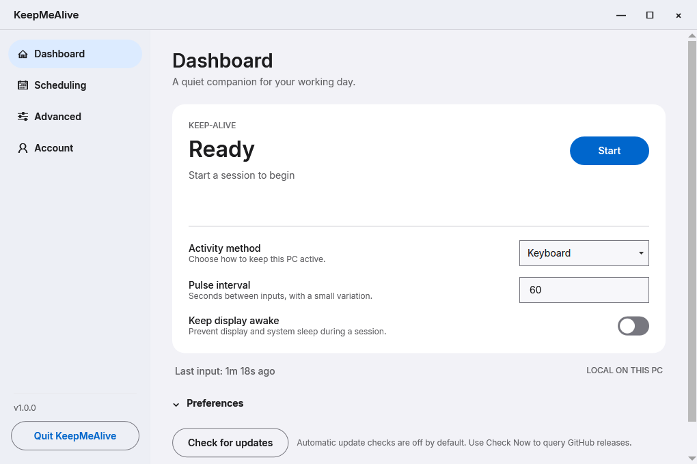

# KeepMeAlive

A native Windows utility for keeping an unlocked session active, with an optional account backed by Neon.

KeepMeAlive runs as a standard user, lives in the system tray, and keeps its input settings and schedules on your PC. Its WPF interface supports light, dark, and system appearance, keyboard navigation, and Windows high contrast.



## Download and run

Validation packages are produced by the [verification workflow](.github/workflows/dotnet-desktop.yml):

- **KeepMeAlive-Portable.zip**: extract the complete archive to a writable directory and run `KeepMeAlive.exe`. Settings default to the adjacent `Data` directory.
- **KeepMeAlive-Setup.exe**: installs for the current user under `%LOCALAPPDATA%\Programs\KeepMeAlive`. Administrator access is not required. Settings default to `%APPDATA%\KeepMeAlive`.

Both packages include the .NET runtime. Windows 11 is the primary target; Windows 10 22H2 remains a compatibility target. A production account release requires the checks in [Release readiness](KeepMeAlive/docs/RELEASE_READINESS.md). An unsigned validation build is not a signed production release.

Native validation covers light/dark pages, actual Windows high contrast and 100/150/175% scaling, calendar/dropdown controls and read-only date entry, invalid scheduling/numeric input, accessible calendar labels, keyboard activation, resizing/maximize/restore, secondary-instance restoration, close-to-tray, clean exit, Neon account restoration, service-outage recovery and artifact rollback. Actual 200% scaling, fresh-user installation/uninstall, spoken screen-reader output, tray-menu clicks and database recovery remain release checks.

## Using the app

1. Choose Keyboard or Mouse and an interval. The default keyboard pulse uses F15, an uncommon function key.
2. Click Start. The Dashboard shows the current session state and next pulse. Native input failures are reported.
3. Click Stop to end the session. The optional system/display power request is released automatically.
4. Closing the window hides it in the system tray. Reopen it through the tray menu or launch it again. Use Quit to exit completely.

Synthetic input can be restricted by Windows or an organization's device policies. The app reports input results, but it cannot guarantee a particular Teams or other application's presence state. Input pauses while the session is locked or suspended.

Scheduling supports one future shutdown, restart, or sleep action. Choose the date from the calendar and enter a 24-hour time as `HH:mm`; the date field is read-only to prevent invalid text from silently reusing an older date. Changes apply when saved; discarding the editor leaves the existing schedule alone. Future saved actions are restored at startup. Missed actions are discarded instead of unexpectedly executing after the PC returns.

## Optional Neon account

The utility works without an account. Sign-in uses the system browser, Authorization Code with PKCE, and user-protected local session storage. The desktop app never receives database passwords or Neon management credentials.

The account screen shows actual connection state and server-managed entitlements. No subscription is required for the local utility, and this version does not introduce checkout or fabricated trial status. See [backend setup](backend/README.md) and [release prerequisites](KeepMeAlive/docs/RELEASE_READINESS.md).

## Privacy and local storage

Automatic update checks and startup account synchronization are disabled by default. Manual sign-in, refresh, and update actions are explicit network requests. There is no telemetry or activity upload.

Session material is encrypted with Windows DPAPI for the current Windows user. Moving portable files to another Windows user or PC requires signing in again. Existing license keys remain protected; storing a key does not validate a subscription.

Preferences use atomic file replacement and recoverable backups. Storage migration copies and verifies both settings and protected data before committing the new location. Protected source copies are retained for recovery; logout clears application-owned session copies. See [Privacy and data flow](KeepMeAlive/docs/PRIVACY_DATA_FLOW.md).

Uninstall removes the installed application and its matching startup registration. Your profile preferences and protected account data are retained. Sign out before uninstalling if you want to remove the local sign-in session.

## Build and verify

Install the .NET SDK selected by `global.json`. The desktop solution and tests require Windows. Backend checks require Node.js 24 or newer.

```powershell
dotnet restore KeepMeAlive.sln --locked-mode
dotnet build KeepMeAlive.sln -c Release --no-restore
dotnet test KeepMeAlive.sln -c Release --no-build
./scripts/Audit-Dependencies.ps1
```

```powershell
Set-Location backend
npm ci
npm run check
npm test
npm run build
```

To produce the portable archive and per-user installer:

```powershell
./scripts/Build-Packages.ps1
```

The packaging script needs Inno Setup 6 or 7. Its compiler can be supplied with `-InnoCompiler`; CI installs the pinned compiler using `scripts/Install-InnoSetup.ps1`, which checks the official download's publisher signature. Packages, SHA-256 checksums, and a dependency inventory are written to `artifacts/packages`. The portable profile uses a separate `packages.publish.lock.json` to pin its bundled runtime patch without changing framework-dependent development requirements.

## Architecture

- **Core**: settings, account/session models, and service contracts.
- **Application**: ViewModels, messages, and keep-alive coordination through interfaces.
- **Infrastructure**: Win32 input/power, local/protected storage, scheduling, startup registration, updates, and account HTTP services.
- **WPF Presentation**: views, resource dictionaries, visual/window adapters, and the composition root.
- **Backend**: authenticated Neon Function API and versioned PostgreSQL migrations.

The repository includes project-local Taste, anti-slop, and Karpathy guidelines. ECC supplies .NET, security-review, and verification guidance. Contributor instructions are in [AGENTS.md](AGENTS.md).

## Release operations

Start with [Publishing step by step](KeepMeAlive/docs/PUBLISHING_STEP_BY_STEP.md) for a plain-language explanation of email delivery, signing, building and uploading a release. Pushing source code does not publish an installer automatically.

[Release procedures](KeepMeAlive/docs/RELEASE.md) describe packaging, signing, backend validation, rollback, and database recovery. Current launch blockers are tracked in [Release readiness](KeepMeAlive/docs/RELEASE_READINESS.md).

[License](LICENSE) · [Issues](https://github.com/GorangN/KeepMeAlive/issues)

Icons use [Tabler Icons](https://github.com/tabler/tabler-icons), distributed under the MIT license. Pinned source SVGs, provenance and native WPF resources are in `KeepMeAlive/Resources/Icons`; the icon license is included with portable and installed distributions.
